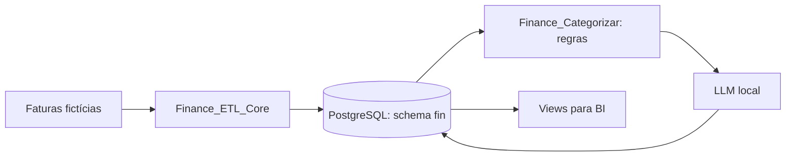

# Fluxo de finanças pessoais

Projeto de portfólio que demonstra um fluxo local de ingestão de faturas,
validação de transações, categorização híbrida e preparação de dados para BI.
O repositório contém somente exemplos sintéticos; não contém faturas, credenciais
ou dados financeiros reais.

Status: teste isolado executado de ponta a ponta com as amostras sintéticas.

## Problema e motivação

Faturas em PDF exigem extração e validação antes de seus dados poderem ser
analisados de forma consistente. Este projeto demonstra um fluxo local e
reproduzível para transformar faturas sintéticas em dados relacionais prontos
para consulta e análise.

## Visão geral



- **Ingestão:** `Finance_ETL_Core` extrai o texto dos PDFs, identifica o
  vencimento, valida a soma da fatura, ignora pagamentos anteriores e carrega
  as transações no PostgreSQL.
- **Idempotência:** compras iguais na mesma data recebem valores distintos em
  `linha`; uma restrição única evita duplicatas ao reprocessar uma fatura.
- **Categorização:** `Finance_Categorizar` aplica regras primeiro e envia ao
  modelo local somente as transações sem categoria.
- **BI:** cinco views no schema `fin` oferecem dimensões e fatos para conexão
  com ferramentas de análise.

## Stack

- Docker Compose.
- n8n `2.4.4` para os fluxos de trabalho (versão testada; veja
  [Limitações](#limitações-e-próximos-passos)).
- PostgreSQL `16` para o modelo relacional e as views.
- llama.cpp com um modelo GGUF local, não incluído no repositório.
- Python e biblioteca padrão para gerar e validar as amostras sintéticas.

As roles separam as permissões por função: `finance_owner` (NOLOGIN) é
proprietária do schema e dos objetos; `finance_app` lê `usuarios`, `categorias` e
`regras_categoria`, lê e grava `bancos`, `contas`, `faturas` e `transacoes` e só
tem `USAGE` nas sequências (nunca exclui, trunca nem altera objetos);
`finance_bi` tem leitura somente das cinco views de relatório.

As cinco views são `fin.dim_categoria`, `fin.dim_conta`, `fin.dim_data`,
`fin.fato_transacoes` e `fin.fato_faturas`.

## Modelo LLM

O modelo utilizado é o Qwen3-4B-Instruct-2507, quantizado em **Q4_K_M**.
O arquivo `Qwen3-4B-Instruct-2507-Q4_K_M.gguf` tem tamanho esperado de
**2.497.281.120 bytes** e SHA-256:

`3605803b982cb64aead44f6c1b2ae36e3acdb41d8e46c8a94c6533bc4c67e597`

Baixe-o com [`scripts/baixar_modelo.sh`](./scripts/baixar_modelo.sh); o
script verifica o SHA-256. A [página do modelo no Hugging Face](https://huggingface.co/unsloth/Qwen3-4B-Instruct-2507-GGUF)
contém as informações de licença; o [arquivo do modelo](https://huggingface.co/unsloth/Qwen3-4B-Instruct-2507-GGUF/resolve/main/Qwen3-4B-Instruct-2507-Q4_K_M.gguf)
é baixado separadamente. Ele **não está no repositório e nunca deve ser
versionado**; `.gitignore` bloqueia arquivos `*.gguf`.

O ETL e as regras funcionam sem o modelo; somente as transações sem
correspondência nas regras são enviadas ao LLM para categorização.

`LLM_BASE_URL` define o endereço base do servidor (padrão `http://llm:8080`)
e `LLM_MODEL` define o nome do modelo (padrão `categorizador`). É possível usar
outro servidor compatível com a API da OpenAI que aceite `response_format`
com `json_schema`; até agora, somente llama.cpp foi testado.

O llama.cpp serve um único modelo e ignora o nome informado na requisição.
Por isso, `LLM_MODEL` só tem efeito em servidores que selecionam o modelo pelo
nome; esse comportamento não foi testado. A configuração testada foi o llama.cpp
com os valores padrão e com uma substituição do alias, mantendo a mesma
`LLM_BASE_URL`. Um endereço `LLM_BASE_URL` diferente ou outro servidor não foi
testado.

O cabeçalho `Authorization`, com a chave da API, é enviado ao endereço definido
em `LLM_BASE_URL`. Ao usar um servidor na nuvem, as descrições das transações
também são enviadas a terceiros; avalie esse risco antes de configurá-lo.

**TODO:** medir memória e velocidade de execução em CPU.

## Amostras e validação

O diretório [`samples/`](./samples/) contém três PDFs fictícios, com datas de
2026 e descrições sintéticas terminadas em `EXEMPLO`. Os casos cobrem compras
duplicadas, estorno, pagamento anterior ignorado, correspondências por regra e
descrições destinadas ao LLM.

Gere ou confira os PDFs com:

```bash
python3 -B tools/gerar_amostras.py
```

O gerador usa somente a biblioteca padrão do Python e confere totais em
centavos, datas, frases do formato e cobertura dos casos. O verificador
independente [`tools/verificar_amostras.py`](./tools/verificar_amostras.py)
extrai o texto dos arquivos e requer `pdftotext` ou o pacote Python `pypdf`.

## Execução isolada

Siga o procedimento em [`docs/RUNNING.md`](./docs/RUNNING.md) para preparar um
clone e executar o conjunto de serviços de teste com o projeto Compose `pfp-test`, portas
dedicadas, credenciais aleatórias e volumes isolados. O procedimento também
documenta a importação dos fluxos de trabalho, a credencial PostgreSQL e as verificações
de permissões, idempotência e views.

O analisador foi construído para **um único formato de fatura**. Para dar suporte a
outro formato, atualize `BANK_KEYWORD` e as regras de extração; valide novamente
com uma amostra sintética antes de alterar o fluxo.

## Resultados

- Faturas processadas: **3**.
- Transações processadas: **11**.
- Transações categorizadas por regra: **8**.
- Transações categorizadas por LLM: **3**.
- Transações sem categoria: **0**.
- Tempo do ETL inicial: **6,118 s**.
- Tempo da categorização: **13,967 s**.
- Tempo da segunda execução do ETL: **6,283 s**.
- Grupo de compras repetidas com `linha` distinta: **1**.
- Estornos armazenados com valor negativo: **1**.
- Pagamentos anteriores importados como transação: **0**.
- Faturas reconciliadas: **3 de 3**.
- Duplicatas após a segunda execução do ETL: **0**.
- Linhas nas views, na ordem `dim_categoria`, `dim_conta`, `dim_data`,
  `fato_transacoes` e `fato_faturas`: **16, 1, 90, 11 e 3**.

Os tempos são a duração total observada nas chamadas da CLI para os fluxos de
trabalho e incluem a inicialização do contêiner temporário.

## Uso com Power BI (sugestão)

As views do schema `fin` foram desenhadas para o Power BI, mas este repositório
**não inclui** nenhum arquivo de dashboard (`.pbix`). Esta seção é uma sugestão
de uso, não uma funcionalidade entregue.

- **Conexão:** use a role `finance_bi`, que lê somente as cinco views. O banco é
  `finance` (padrão de `POSTGRES_DB`) e a porta é a de `POSTGRES_PORT`. O
  PostgreSQL escuta apenas em `127.0.0.1`; para conectar o Power BI Desktop de
  outra máquina, abra um túnel SSH até o servidor.
- **Relacionamentos (esquema em estrela):**
  - `fato_transacoes[data]` → `dim_data[data]`;
  - `fato_transacoes[categoria_id]` → `dim_categoria[categoria_id]`;
  - `fato_transacoes[conta_id]` → `dim_conta[conta_id]`;
  - `fato_faturas[conta_id]` → `dim_conta[conta_id]`.
- **Medidas sugeridas:** gasto por mês (`SUM(valor)`; estornos têm valor
  negativo), participação por categoria, variação em relação ao mês anterior,
  maiores categorias e a proporção de transações categorizadas por regra, por LLM
  ou ainda sem categoria (`categoria_fonte` e `sem_categoria`).

## Limitações e próximos passos

- O analisador atende a um único formato de fatura.
- Os gatilhos de IMAP e webhook estão desativados nos fluxos de trabalho.
- A precisão da categorização por LLM ainda não foi medida.
- O n8n está fixado na versão `2.4.4`, a testada, para manter a execução
  reproduzível. Essa versão tem uma falha conhecida de escape de expressões
  (CVE-2026-25049, corrigida na `2.5.2`), explorável por quem consegue criar ou
  editar fluxos. Por isso, o n8n escuta somente em `127.0.0.1`, os fluxos
  importados ficam inativos e o ambiente é para testes locais com dados
  sintéticos. Importe apenas fluxos em que você confia e **não exponha a porta do
  n8n**. Atualizar a versão exige repetir o teste de ponta a ponta.
- `N8N_BLOCK_ENV_ACCESS_IN_NODE=false` permite que qualquer fluxo ou nó de código
  da instância leia **todas** as variáveis de ambiente do contêiner n8n, incluindo
  `N8N_ENCRYPTION_KEY` e `LLM_API_KEY`. Use somente chaves de teste e fluxos
  confiáveis. Uma alternativa, não implementada, é guardar a chave do LLM em uma
  credencial do n8n e reativar o bloqueio.
- A categorização por LLM pode terminar sem erro e sem categorias do LLM se o
  modelo ainda não terminou de carregar. Aguarde o servidor responder (veja
  [`docs/RUNNING.md`](./docs/RUNNING.md)) e confira que não restam transações
  sem categoria.
- Próximos passos: medir a qualidade da categorização com um conjunto sintético
  rotulado e avaliar novos formatos de fatura antes de ampliar o analisador.
- Ideias em aberto (não implementadas): um modelo do Power BI (`.pbit`, sem
  dados) construído sobre as amostras sintéticas, e um assistente que consulte as
  views com a role `finance_bi`, que só tem permissão de leitura.

## Habilidades demonstradas

- Construção de ETL e validação de dados.
- Modelagem relacional.
- Contêineres com Docker e Docker Compose.
- Automação de processos com n8n.
- Integração com LLM local.
- Controle de acesso com roles de privilégio mínimo.

## Segurança

- Não use faturas ou dados financeiros reais neste repositório.
- Não versione `.env`, chaves, senhas, backups ou modelos GGUF.
- O modelo deve permanecer local; somente um diretório isolado com o arquivo
  GGUF necessário é montado como leitura no procedimento de teste.
- A validação ponta a ponta documentada usa somente as amostras fictícias; ela
  não representa uma validação com extratos ou faturas reais.

## Licença

Distribuído sob a licença MIT. Veja [`LICENSE`](./LICENSE). O modelo GGUF não faz
parte do repositório e tem a sua própria licença, indicada na página do modelo.
