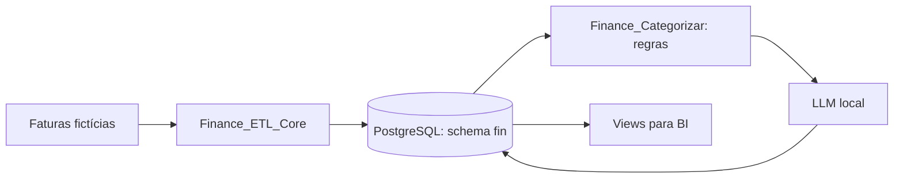

# Fluxo de finanças pessoais

Projeto de portfólio que demonstra um fluxo local de ingestão de faturas,
validação de transações, categorização híbrida e preparação de dados para BI.
O repositório contém somente exemplos sintéticos; não contém faturas, credenciais
ou dados financeiros reais.

Status: teste isolado executado de ponta a ponta com as amostras sintéticas.

## Problema e motivação

Faturas em PDF exigem extração e validação antes de seus dados poderem ser
analisados de forma consistente. Este projeto demonstra um fluxo local e
reproduzível para transformar faturas sintéticas em dados relacionais prontos
para consulta e análise.

## Visão geral



- **Ingestão:** `Finance_ETL_Core` extrai o texto dos PDFs, identifica o
  vencimento, valida a soma da fatura, ignora pagamentos anteriores e carrega
  as transações no PostgreSQL.
- **Idempotência:** compras iguais na mesma data recebem valores distintos em
  `linha`; uma restrição única evita duplicatas ao reprocessar uma fatura.
- **Categorização:** `Finance_Categorizar` aplica regras primeiro e envia ao
  modelo local somente as transações sem categoria.
- **BI:** cinco views no schema `fin` oferecem dimensões e fatos para conexão
  com ferramentas de análise.

## Stack

- Docker Compose.
- n8n `2.4.4` para os fluxos de trabalho.
- PostgreSQL `16` para o modelo relacional e as views.
- llama.cpp com um modelo GGUF local, não incluído no repositório.
- Python e biblioteca padrão para gerar e validar as amostras sintéticas.

As roles seguem privilégio mínimo: `finance_owner` (NOLOGIN) é proprietária do
schema e dos objetos; `finance_app` recebe somente leitura e gravação necessárias
ao ETL; `finance_bi` tem leitura das views de relatório.

As cinco views são `fin.dim_categoria`, `fin.dim_conta`, `fin.dim_data`,
`fin.fato_transacoes` e `fin.fato_faturas`.

## Amostras e validação

O diretório [`samples/`](./samples/) contém três PDFs fictícios, com datas de
2026 e descrições sintéticas terminadas em `EXEMPLO`. Os casos cobrem compras
duplicadas, estorno, pagamento anterior ignorado, correspondências por regra e
descrições destinadas ao LLM.

Gere ou confira os PDFs com:

```bash
python3 -B tools/gerar_amostras.py
```

O gerador usa somente a biblioteca padrão do Python e confere totais em
centavos, datas, frases do formato e cobertura dos casos. O verificador
independente [`tools/verificar_amostras.py`](./tools/verificar_amostras.py)
extrai o texto dos arquivos e requer `pdftotext` ou o pacote Python `pypdf`.

## Execução isolada

Siga o procedimento em [`docs/RUNNING.md`](./docs/RUNNING.md) para preparar um
clone e executar o conjunto de serviços de teste com o projeto Compose `pfp-test`, portas
dedicadas, credenciais aleatórias e volumes isolados. O procedimento também
documenta a importação dos fluxos de trabalho, a credencial PostgreSQL e as verificações
de permissões, idempotência e views.

O analisador foi construído para **um único formato de fatura**. Para dar suporte a
outro formato, atualize `BANK_KEYWORD` e as regras de extração; valide novamente
com uma amostra sintética antes de alterar o fluxo.

## Resultados

- Faturas processadas: **3**.
- Transações processadas: **11**.
- Transações categorizadas por regra: **8**.
- Transações categorizadas por LLM: **3**.
- Transações sem categoria: **0**.
- Tempo do ETL inicial: **6,118 s**.
- Tempo da categorização: **13,967 s**.
- Tempo da segunda execução do ETL: **6,283 s**.
- Grupo de compras repetidas com `linha` distinta: **1**.
- Estornos armazenados com valor negativo: **1**.
- Pagamentos anteriores importados como transação: **0**.
- Faturas reconciliadas: **3 de 3**.
- Duplicatas após a segunda execução do ETL: **0**.
- Linhas nas views, na ordem `dim_categoria`, `dim_conta`, `dim_data`,
  `fato_transacoes` e `fato_faturas`: **16, 1, 90, 11 e 3**.

Os tempos são a duração total observada nas chamadas da CLI para os fluxos de
trabalho e incluem a inicialização do contêiner temporário.

## Dashboard

**TODO:** adicionar capturas de um dashboard construído exclusivamente com os
dados sintéticos deste repositório.

## Limitações e próximos passos

- O analisador atende a um único formato de fatura.
- Os gatilhos de IMAP e webhook estão desativados nos fluxos de trabalho.
- A precisão da categorização por LLM ainda não foi medida.
- A chave do LLM é disponibilizada ao n8n por uma variável de ambiente; use
  somente uma chave de teste neste ambiente.
- Próximos passos: medir a qualidade da categorização com um conjunto sintético
  rotulado e avaliar novos formatos de fatura antes de ampliar o analisador.

## Habilidades demonstradas

- Construção de ETL e validação de dados.
- Modelagem relacional.
- Contêineres com Docker e Docker Compose.
- Automação de processos com n8n.
- Integração com LLM local.
- Controle de acesso com roles de privilégio mínimo.

## Segurança

- Não use faturas ou dados financeiros reais neste repositório.
- Não versione `.env`, chaves, senhas, backups ou modelos GGUF.
- O modelo deve permanecer local; somente um diretório isolado com o arquivo
  GGUF necessário é montado como leitura no procedimento de teste.
- A validação ponta a ponta documentada usa somente as amostras fictícias; ela
  não representa uma validação com extratos ou faturas reais.
